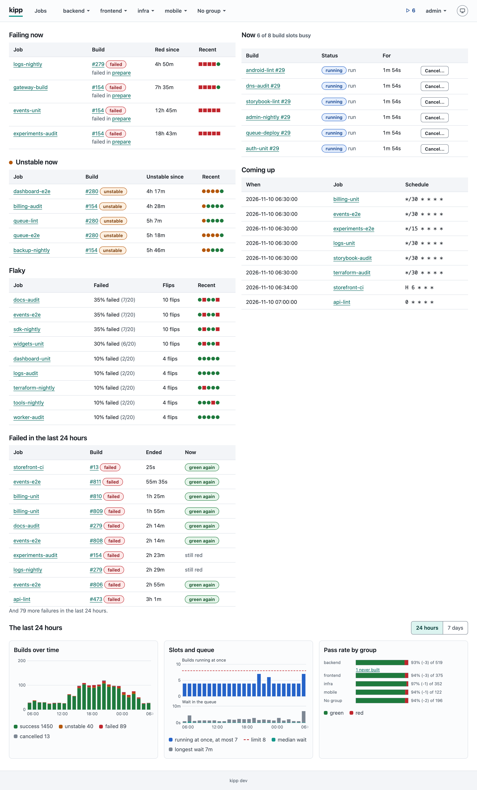
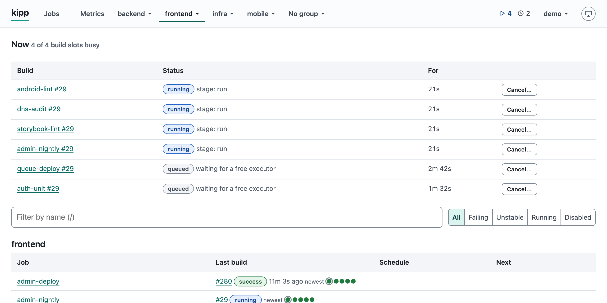
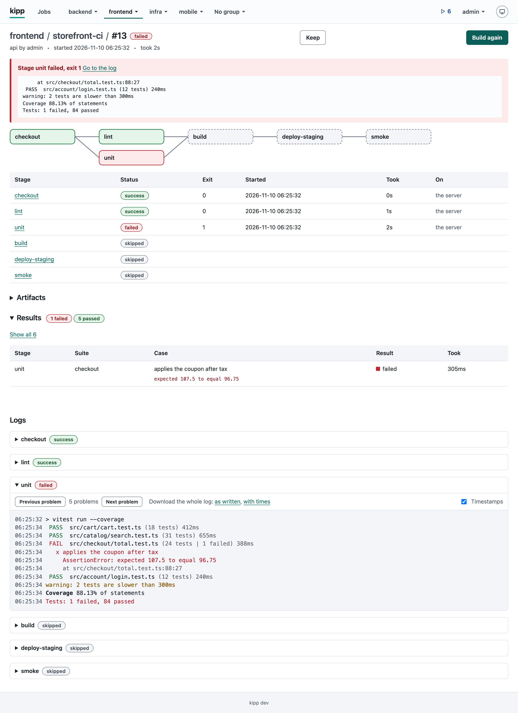
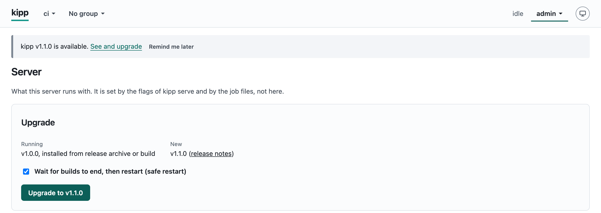

# kipp

kipp is a job-first CI and scheduler in a single binary. Jobs are YAML
files in a directory; builds run as shell commands on the server's
machine, on agents that dial in, or in containers on Docker engines;
everything else (builds, users, secrets) is kept in one SQLite file.

It runs cron jobs with a history, a log and a page per build, stages
that form a DAG, builds from GitHub pushes, tags and pull requests, and
has a JSON API and a command line that can do all a browser can.







## Features

- **Jobs as files.** One `<name>.yml` per job in a directory, shared
  variables in `_vars.yml`, checked offline with `kipp check` and read
  again on `kipp reload` or `SIGHUP`. A directory with one bad file is
  refused whole, and the server keeps the jobs it had.
- **Triggers.** Cron with Jenkins' `H` to spread jobs over the hour and a
  time zone per job, GitHub webhooks on a push or a tag, a run after
  another job, and by hand from the job's page, the API or `kipp run`,
  with typed parameters.
- **Stages.** A DAG with `needs`, conditions (`when`), retries, exit codes
  that mean unstable, locks, a timeout, and variables handed from one stage
  to the next.
- **Multibranch jobs and organization folders.** Every branch and pull
  request of a repo, or every repo of a GitHub user or organization, built
  from a `.kipp.yml` in the repo, with commit statuses, signed in with a
  token or as a GitHub App.
- **Agents and engines.** Standing agents on other machines and containers
  on Docker engines (over a socket, TLS or ssh), chosen by label.
- **Build results.** A live log with timestamps and colours, JUnit test
  results, artifacts, a keyed cache shared between builds, and metrics
  with guards that fail a build when a number falls.
- **Accounts.** Users with per-job grants (view, build, cancel), API
  tokens, secrets sealed in the database and masked in the logs, and an
  audit of every change.

## Install

On macOS or Linux with Homebrew:

```sh
brew install ndthuan/tap/kipp
brew services start kipp
```

The service keeps the job files in `$(brew --prefix)/etc/kipp` and the
data in `$(brew --prefix)/var/kipp`, and listens on `127.0.0.1:8085`.

With Docker:

```sh
docker run -d --name kipp -p 8085:8085 \
  -v kipp-data:/var/lib/kipp -v ./jobs:/etc/kipp ghcr.io/ndthuan/kipp
```

`/var/lib/kipp` is the data directory and `/etc/kipp` the job files.

Release archives for Linux and macOS on amd64 and arm64, with
`SHA256SUMS` with its signature `SHA256SUMS.sig`, and a build provenance
attestation, are on the
[releases page](https://github.com/ndthuan/kipp/releases). To build from
source, `make build` (Go 1.27.3 or newer) gives `bin/kipp`.

[docs/install.md](docs/install.md) has every way in detail, with how to
check an archive, how to upgrade and what the server needs.

A running server asks GitHub for the latest release at start and about
every 12 hours, one request that carries nothing about your jobs or your
install beyond what any HTTP request does, and says on its Server page when a newer one exists. Turn it off with
`kipp serve --no-update-check` or `KIPP_NO_UPDATE_CHECK=1`
([details](docs/install.md#the-update-check)).

## Quick start

Write a job and start the server. `serve` stays in the foreground, so
this is one terminal (a Homebrew service started above listens on the
same port: stop it first with `brew services stop kipp`):

```sh
mkdir jobs
printf 'name: hello\nstages:\n  greet: {run: echo hello}\n' > jobs/hello.yml
kipp serve --data ./data --jobs ./jobs
```

It prints where it listens:

```
kipp v1.0.0 listening on http://127.0.0.1:8085, 1 job from ./jobs, data in /home/alice/data
```

In a second terminal, in the same directory, make the first admin and a
token, and run the job:

```sh
kipp user add admin --admin --data ./data
kipp token create admin --label laptop --data ./data
KIPP_TOKEN=<the token> kipp run hello --wait
```

which print, in turn:

```
admin password: <a generated password, shown once>
token for admin (laptop), shown once:
kipp_<the token>
hello #1 queued (build 1)
[greet] hello
hello #1: success
```

Log in at the address `serve` printed, as `admin` with that password, to
see the build. `kipp check <jobs-dir>` says what is wrong with a
directory of job files without starting anything, and `kipp <command> -h`
prints a command's flags.

## The first admin

There is no default user and no default password. The first admin is
made on the server's machine, on the data directory, after `kipp serve`
has started once and made it:

```sh
kipp user add admin --admin --data <data-dir>
```

It prints a generated password, once. To choose the password instead,
pipe it in with `--password-stdin`. With Homebrew the data directory is
`$(brew --prefix)/var/kipp`; in the container it is `/var/lib/kipp`:

```sh
docker exec kipp kipp user add admin --admin --data /var/lib/kipp
```

Everyone else is added by an admin, on the Users page or with
`kipp user add`.

## Upgrading

When a newer release exists, every page shows an admin a banner, and the
Server page has an Upgrade card with the running version, where it was
installed from, the new version's release notes and one button. By default
it makes kipp quiet, waits for the running builds to end, backs up the data
directory and restarts into the new version, which the launcher puts back if
it does not come up; unticking the box restarts at once after asking again.
`kipp upgrade` does the same from the command line, and `kipp upgrade
--rollback` goes back. It works for Homebrew, Docker and a release archive
alike, with no `brew` or `docker` to run, and the download is checked
against a signed `SHA256SUMS` first.
[Upgrading](docs/install.md#upgrading) has the steps, the same by hand,
rollback and what a failed upgrade looks like; a release can be
[checked by hand](docs/install.md#verifying-a-release-by-hand) too.



## Documentation

- [Install](docs/install.md): Homebrew, Docker, release archives, from
  source, upgrading and rolling back, checking a release, and what the
  server needs.
- [Job files](docs/jobs.md): every key of a job file, triggers, stages,
  conditions, variables and `_vars.yml`.
- [Multibranch jobs](docs/multibranch.md): every branch and pull request
  of a repo, from a `.kipp.yml` in it.
- [Organization folders](docs/organization-folders.md): every repo of a
  GitHub user or organization, with a token or a GitHub App.
- [Builds](docs/builds.md): statuses, logs, the queue, test results,
  artifacts and the cache.
- [Metrics](docs/metrics.md): numbers builds report, what a store
  remembers, and guards.
- [Agents and engines](docs/agents.md): stages on other machines and in
  containers.
- [Accounts and security](docs/accounts.md): users, grants, tokens,
  secrets, and how logins and secrets are protected.
- [The API](docs/api.md): `/api/v1`, its errors, lists and routes.
- [The MCP endpoint](docs/mcp.md): `--mcp`, for Claude and other MCP
  clients, with the tools and how to connect.
- [Commands](docs/cli.md): every `kipp` command, its flags and exit
  codes.
- [Operations](docs/operations.md): running as a service, behind a proxy,
  restarting without losing builds, the data directory, backups and what
  an upgrade leaves in it.

[`examples/`](examples) has sample jobs, notification hooks, service
files for systemd and launchd, and proxy configurations.
[CONTRIBUTING.md](CONTRIBUTING.md) says how to send a change and
[SECURITY.md](SECURITY.md) how to report a vulnerability.

## Licence

MIT, see [LICENSE](LICENSE). What the binary embeds of other people's work
is listed in [THIRD_PARTY.md](THIRD_PARTY.md).
