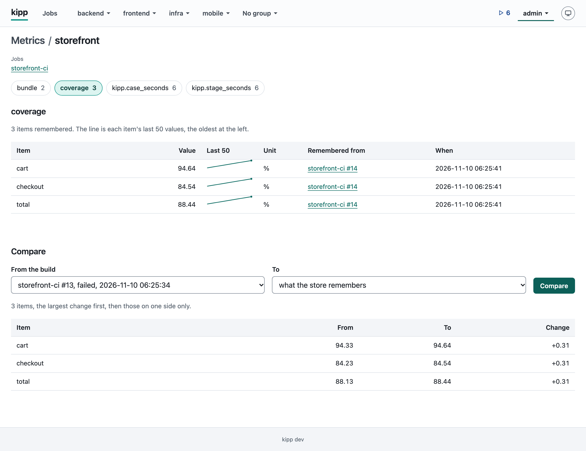

# Metrics

kipp keeps the numbers builds measure, and can fail a stage when one of
them falls. A metric is a named number (`seconds`, `coverage`) measured
for an item (a unit, a file, a page, `total`).

- [Stores](#stores)
- [Reporting](#reporting)
- [What a store remembers](#what-a-store-remembers)
- [KIPP_METRICS](#kipp_metrics)
- [Guards](#guards)
- [Pages](#pages)
- [API](#api)
- [Commands](#commands)

## Stores

Metrics live in a store, named by the job's `metrics.store` (default the
job's name; several jobs may name one store):

```yaml
name: site-smoke
metrics:
  store: site
  remember:
    - {metrics: [coverage], when: {default_branch: true, status: [success]}}
    - {metrics: [seconds], when: {status: [success, unstable, failed]}}
stages:
  measure:
    run: ./measure.sh
    metrics:
      file: "metrics-*.json"
      guard:
        - {metric: coverage, item: total, no_lower: true, tolerance: 0.01}
```

Every value a build reports is kept with the build, as its history, and
goes when `keep` removes the build. What the store holds for each item is
its remembered value: the last one that a build `remember` lets through
reported. It stays until a complete report or `kipp metrics forget` takes
it, and names the build it came from by job and number, so it outlives
that build.

## Reporting

A stage reports with `metrics: {file: <glob>}`, a glob in the stage's
directory as `junit:` is. The files it matches are read in name order
once the command exits, whatever its exit code, and a later file's item
wins:

```json
{
  "metrics": [
    {"name": "seconds", "unit": "s", "complete": true,
     "values": {"home page": 1.5, "checkout": 12}},
    {"name": "coverage", "unit": "%", "values": {"total": 87.19}}
  ]
}
```

- A name is lower-case letters, digits, `.`, `-` and `_`, and never
  starts `kipp.`. `unit` is free text of 16 bytes at most, and may be left
  out. An item is 1 to 512 bytes of UTF-8 with no control character. A
  value is a finite number, and nothing else (a set of names is a metric
  whose value 0 means "not there").
- A file is 16 MiB at most, a stage's report 100,000 items at most, and
  items and units are masked for secrets as the logs are.
- `complete: true` says the report holds every item of the metric: the
  store then forgets the items it does not name. Without it the report
  merges, item by item.
- A file that does not parse, an entry or an item that breaks a rule,
  and a glob that matches nothing are each a line `kipp: metrics: ...` in
  the stage's log; the rest is kept, and the stage ends as its command
  did, unless a guard needs what is missing.

kipp records two metrics of every build by itself: `kipp.stage_seconds`
(item the stage's name: how long its command ran, all tries together)
and `kipp.case_seconds` (item `<suite> / <case>`: each JUnit case that
was not skipped). The history of `kipp.case_seconds` keeps the newest 30
builds of each case per job; the daily sweep removes older rows.

On a runner or in a container the files are read there and sent back.

## What a store remembers

`remember` says which metrics a build updates the store with. Each rule
names `metrics` (none: every metric, `kipp.*` too) and a `when` that
takes the keys of a stage's [`when`](jobs.md#conditions-when) (`params`
too, not `needs_status`) and `status`, the build's final status: any of
`success`, `unstable` and `failed` (default `success` and `unstable`). A
rule with no `when`, or a `when` with no key, is refused, and `status` is
refused in a stage's `when`.

- A cancelled, timed out or lost build never updates the store.
- The first rule that names a metric decides it, and a metric no rule
  names is kept in history only.
- A job with no `remember` has one rule: every metric,
  `{default_branch: true, status: [success, unstable]}`.
- The store is updated once the build's status is final, in one
  transaction, and a build whose rule does not hold forgets nothing,
  complete report or not.

## KIPP_METRICS

Before a stage that declares `metrics` starts (`metrics: {}` reads and
reports nothing), kipp writes what its store remembers to a file in the
build's workspace and names it in `KIPP_METRICS`, on a runner too, so the
stage reads the numbers with no token:

```json
{
  "store": "site",
  "metrics": [
    {"name": "coverage", "unit": "%",
     "values": {"total": 87.19},
     "from": {"total": {"job": "site-deploy", "number": 123, "at": "2026-10-29T03:00:00Z"}}}
  ],
  "guards": [
    {"metric": "coverage", "item": "total", "no_lower": true, "tolerance": 0.01, "on_fall": "failed", "required": true}
  ]
}
```

`from` names, per item, the build that set its value (job `cli` and
number 0 for one put by `kipp metrics put`): a report that merges leaves
the items of one metric from different builds. `guards` are the stage's,
with their defaults filled in. A stage with no `metrics` has no
`KIPP_METRICS`.

## Guards

`guard` on a stage's `metrics` fails the stage when a metric it reports
fell against what the store remembers. Each guard names:

- `metric`;
- `item`: an exact name, or a `path.Match` pattern: every item of the
  metric the report holds or the store remembers that it matches is
  guarded;
- `no_lower: true`, the one rule there is, which must be said;
- `tolerance` (default 0): how far the value may fall. A value below the
  remembered one less the tolerance is a fall;
- `on_fall`: how a fall ends the stage, `failed` (the default) or
  `unstable`; what needs the stage then runs or is skipped as after any
  stage that ended so;
- `required` (default `true`): an item the report lacks, or a report that
  is missing or does not parse, fails the guard as `missing` (and ends the
  stage `on_fall`), so a stage that stopped reporting is not waved
  through. With `required: false` it passes as `not reported`, for a
  stage that measures only on some runs.

An item the store remembers no value of passes, and says `no baseline`.
The guards are applied once the command has exited with a status that is
not `failed`: a stage that failed by itself, or was stopped, is not
judged. They judge against the `KIPP_METRICS` the stage was given, so a
build that updates the store meanwhile changes no verdict. Each result is
a line in the stage's log, a row on the build's page, and kept with the
build:

```
kipp: metrics guard: coverage total 87.19 -> 86.90 (-0.29), remembered from site-deploy #123, tolerance 0.01: failed
```

Values have two decimals (more when two would hide a change), and the
delta its sign; where a side has no value it says why instead:
`no baseline -> 86.90`, `87.19 -> missing`, `87.19 -> not reported`. The
store the guard reads is the one `remember` keeps, so with the default
rule a branch is judged against what the default branch last measured.

A guard after the stage comes too late for a stage that decides
something itself, such as one that checks a branch and merges it in one
command. Such a stage runs the same guards before it decides, with
`"$KIPP_BIN" metrics check <glob>` ([Commands](#commands)): offline, with
no token, on the server, a runner and in a container alike. The guard
after the stage still runs.

## Pages

The Metrics page (`/metrics`, beside Jobs in the header) lists the
stores you may see, an orphaned one marked for an admin. A store's page
(`/metrics/<store>`, linked from the page of each job that names it)
shows one metric at a time: per item the value the store remembers, its
unit, the build it came from and when, and a line of the item's last 50
values in history, oldest at the left. A heading sorts the table by its
column. Below it, a form compares a build with another or with what the
store remembers. A table lists 1,000 rows at most; the API answers every
one.



A store is shown to whoever may view at least one loaded job that names
it (by `metrics.store` or by its own name). An admin sees every store,
the orphaned ones too, which no loaded job names. Any other store is
answered 404, as a job one may not view is.

## API

Each answer is JSON in the shapes of [The API](api.md#shapes).

- `GET /api/v1/metrics`: the stores that remember anything, by name, each
  with the loaded jobs the caller may view that name it, whether it is
  orphaned, and how many items it remembers of each metric:

  ```json
  {"items": [{"store": "site", "jobs": ["site-deploy", "site-smoke"], "orphaned": false,
              "metrics": [{"name": "coverage", "items": 1}, {"name": "seconds", "items": 182}]}],
   "next_cursor": null}
  ```

- `GET /api/v1/metrics/<store>`: the store as the list above holds it.
- `GET /api/v1/metrics/<store>/remembered?metric=<name>`: what the store
  remembers, of the one metric or (without `metric`) of every metric, by
  metric and item, each with the build that set it (`id` 0, job `cli`
  and number 0 for a value `kipp metrics put` set; the build itself may
  be gone, as its value outlives it) and when:

  ```json
  {"items": [{"metric": "coverage", "item": "total", "value": 87.19, "unit": "%",
              "build": {"id": 4711, "job": "site-deploy", "number": 123, "status": "success"},
              "at": "2026-10-29T03:00:00.000Z"}],
   "next_cursor": null}
  ```

- `GET /api/v1/metrics/<store>/history?metric=<name>&item=<item>`: what
  each build reported of the item, newest first, each with its stage and
  when the build ended; paged ([Lists](api.md#lists)), 100 rows by
  default. History goes with its build under `keep`.

  ```json
  {"items": [{"build": {"id": 4711, "job": "site-deploy", "number": 123, "status": "success"},
              "stage": "measure", "value": 87.19, "unit": "%", "at": "2026-10-29T03:00:00.000Z"}],
   "next_cursor": null}
  ```

- `GET /api/v1/metrics/<store>/compare?metric=<name>&from=<build id>&to=<build id|remembered>`:
  the metric item by item between what the build `from` reported into the
  store and what the build `to` did, or what the store remembers
  (`to=remembered`). `delta` is `to` minus `from`, rounded to as many
  decimals as the two are written with; a side with no value is null, and
  so is its `delta`. The rows come largest change first, then the items
  on one side only, each part by item. A build one may not view is
  answered 404.

  ```json
  {"items": [{"item": "lib/cart.js", "from": 201, "to": 150, "delta": -51},
             {"item": "lib/menu.js", "from": 40, "to": 41, "delta": 1},
             {"item": "lib/new.js", "from": null, "to": 12, "delta": null}],
   "next_cursor": null}
  ```

- `GET /api/v1/builds/<id>/metrics`: what the build reported, stage by
  stage, with what each guard of the stage found (`from` is the build the
  remembered value came from, `line` the line in the stage's log).
  `verdict` is `held`, `no baseline`, `fell`, `missing` or
  `not reported`; `outcome` is how it ended the stage: `held`, `failed`
  or `unstable`.

A metric, an item or a build id the request leaves out, or one that is
not a build id, is answered 400.

## Commands

`kipp metrics check <glob>` runs inside a stage that declares `metrics`.
It applies the guards `KIPP_METRICS` holds to the report files the glob
matches (a path, absolute or from the working directory, whose last
element may be a pattern) against the values `KIPP_METRICS` holds, as the
guard after the stage will, and prints each result as that guard's line.
It needs no data directory, no server and no token. It exits:

| Code | Meaning |
|---|---|
| 0 | No guard ended `failed` (a fall whose `on_fall` is `unstable` is printed and left to the guard after the stage). |
| 1 | A guard ended `failed`. |
| 2 | `KIPP_METRICS` is not set or cannot be read, or the command line is wrong. |
| 3 | `KIPP_METRICS` holds no guard. |

What 2 and 3 mean is the caller's to decide: a script that must not merge
unchecked fails on both 1 and 2, and a job with no guard declared has
chosen none. In a container `$KIPP_BIN` is `kipp-runner`, which has the
same command:

```sh
if "$KIPP_BIN" metrics check "$KIPP_WORKSPACE/metrics-coverage.json"; then ./merge.sh; fi
```

On the server's machine, on the data directory:

- `kipp metrics put <store> --file <report.json> [--job <name>] --data <dir>`
  remembers a report, in the format a stage's `metrics.file` is, as a
  build of `--job` (default `cli`, number 0) would have: a complete metric
  replaces what the store had of it. A report with anything wrong in it
  is refused whole.
- `kipp metrics forget <store> [--metric <name> [--item <item>]] --data <dir>`
  forgets an item, every item of a metric, or everything the store
  remembers, and says how many items went; the history of builds is not
  touched.
- `kipp metrics ls [--store <name>] [--jobs <dir>] --data <dir>` prints a
  line per store and metric with its count of items; with `--jobs` a store
  no job file there names is marked `orphaned`. Such a store is kept until
  it is forgotten.
